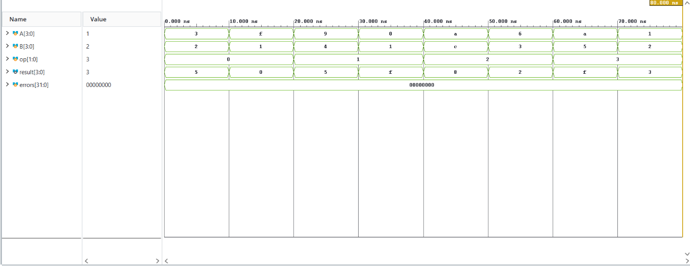
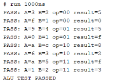
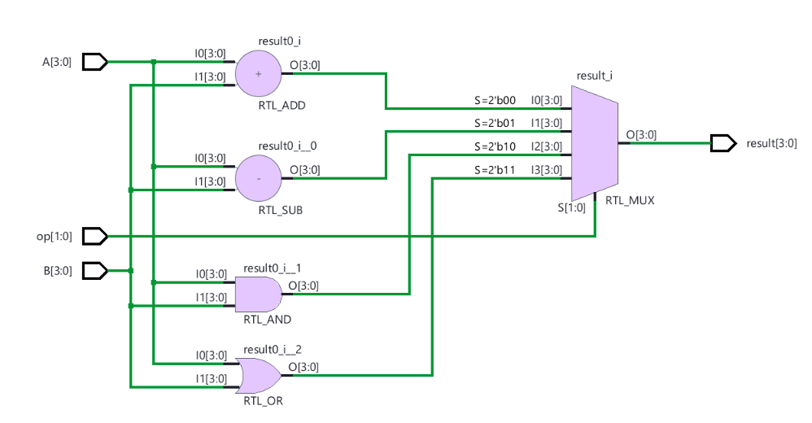
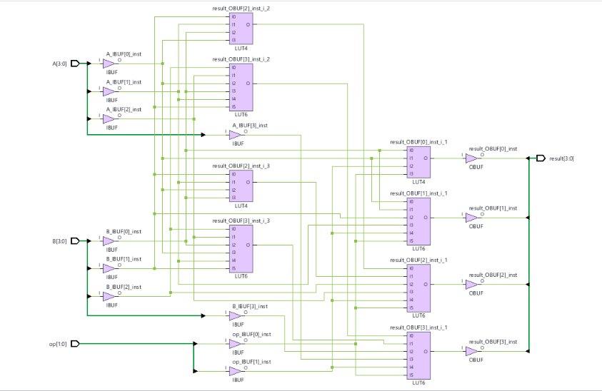

# 4-Bit Combinational ALU

The `alu_4bit` module is a synthesizable, 4-bit combinational Arithmetic Logic Unit (ALU) implemented in Verilog HDL (IEEE 1364-2001). It performs four fundamental arithmetic and logical operations—addition, subtraction, bitwise AND, and bitwise OR—steered by a 2-bit operation select code (`op`). The module is designed for zero-latency execution datapaths in compact microcontrollers, digital signal processors, and educational RISC cores, synthesizing cleanly into Look-Up Table (LUT) logic without inferred transparent latches.

## File Header

```text
// File name   : alu_4bit.v
// Title       : 4-Bit Combinational ALU
// Project     : Verilog Works
// Created     : 2026-11-17
// Description : Synthesizable 4-bit combinational ALU executing addition, subtraction, AND, and OR
```

## Overview

In digital arithmetic datapaths, the Arithmetic Logic Unit executes core computational operations required by processor instruction sets. This design implements an unclocked, purely combinational 4-bit ALU that maps operand inputs `A` and `B` to a 4-bit output `result` according to the control vector `op`.

By utilizing an implicit sensitivity list (`always @(*)`) and an exhaustive `case` construct with an explicit `default` fallback, the RTL eliminates unwanted latches and guarantees deterministic static timing analysis paths.

### Digital Design Principles Utilized

- **Combinational Datapath Execution**: Zero clock-cycle propagation delay from input transition to output settlement.
- **Arithmetic & Logic Multiplexing**: Operation decoding steering parallel arithmetic adder/subtractor logic and bitwise gates into a single output bus.
- **Modulo-$2^4$ Wrap-Around Handling**: Natural 4-bit unsigned arithmetic handling overflow (`15 + 1 = 0`) and underflow borrow (`0 - 1 = 15`).
- **Defensive Case Branching**: Complete state enumeration preventing synthesis-time latch inference.

---

## Features

- **Verilog-2001 Synthesizable RTL**: Standards-compliant, highly portable register-transfer level code.
- **4 Fundamental Operations**: Addition (`+`), subtraction (`-`), bitwise AND (`&`), and bitwise OR (`|`).
- **Zero Inferred Latches**: Fully specified `case` branches with a safe `default: result = 4'b0000;` clause.
- **FPGA Technology Mapping**: Directly targets Look-Up Table (LUT) architectures, minimizing logic depth and propagation delay.
- **Self-Checking Testbench**: Automated testbench with procedural verification tasks checking arithmetic carry wrap-around, borrow underflow, and bitwise mask operations.

---

## Architecture

The module receives two 4-bit operands (`A`, `B`) and a 2-bit operation selector (`op`). A parallel combinational decoding network evaluates the selected operation and drives `result[3:0]`.

```text
                     ┌───────────────────────────────────┐
                     │             alu_4bit              │
                     │          (4-Bit Comb ALU)         │
                     │                                   │
        A[3:0] ══════╡                                   │
                     │   Arithmetic & Bitwise Datapath   ╞════► result[3:0]
        B[3:0] ══════╡                                   │
                     │                                   │
       op[1:0] ──────┴─► [Opcode Decoder]                │
                     └───────────────────────────────────┘
```

### Datapath & Control Flow

1. **Inputs**: Operands `A[3:0]` and `B[3:0]` and selection vector `op[1:0]` enter the module boundary.
2. **Operation Decoding**: The 2-bit `op` selector activates the corresponding functional slice.
3. **Evaluation**:
   - `op = 2'b00`: Computes sum `A + B`.
   - `op = 2'b01`: Computes difference `A - B` using two's complement subtraction.
   - `op = 2'b10`: Computes bitwise conjunction `A & B`.
   - `op = 2'b11`: Computes bitwise disjunction `A | B`.
4. **Output**: Driven combinationally onto `result[3:0]`.

---

## Module Hierarchy

| Module Name | Type | Purpose | Source File |
|-------------|------|---------|-------------|
| `alu_4bit` | Top / DUT | Synthesizable 4-bit combinational ALU | [`alu_4bit.v`](alu_4bit.v) |
| `tb_alu_4bit` | Testbench | Verification harness and self-checking testbench | [`tb_alu_4bit.v`](tb_alu_4bit.v) |

---

## Interface (Ports & Parameters)

### Port List

| Port | Direction | Width | Type | Polarity / Trigger | Description |
|------|-----------|-------|------|--------------------|-------------|
| `A` | Input | `4` | `wire` | Level | Primary 4-bit operand bus |
| `B` | Input | `4` | `wire` | Level | Secondary 4-bit operand bus |
| `op` | Input | `2` | `wire` | Level | 2-bit operation code selector |
| `result` | Output | `4` | `reg` | Level (Combinational) | Computed 4-bit arithmetic/logic output |

---

## Opcode Table

| `op[1:0]` | Operation | RTL Expression | Mathematical Behavior | Corner Case Handled |
|-----------|-----------|----------------|------------------------|---------------------|
| `2'b00` | Addition (`ADD`) | `result = A + B` | 4-bit unsigned sum | Modulo-16 overflow (`15 + 1 = 0`) |
| `2'b01` | Subtraction (`SUB`) | `result = A - B` | 4-bit two's complement difference | Underflow borrow wrap (`0 - 1 = 15`) |
| `2'b10` | Bitwise AND (`AND`) | `result = A & B` | Bit-by-bit logical conjunction | Masking bit verification |
| `2'b11` | Bitwise OR (`OR`) | `result = A \| B` | Bit-by-bit logical disjunction | Bitwise assertion merging |
| `default` | Safe Fallback | `result = 4'b0000` | Zero clamp | Prevents latch inference |

---

## RTL Implementation Details

### Sequential vs. Combinational Separation

The design is modeled using a purely combinational procedural block with the Verilog-2001 implicit sensitivity list token `always @(*)`:

```verilog
always @(*) begin
    case (op)
        2'b00: result = A + B;
        2'b01: result = A - B;
        2'b10: result = A & B;
        2'b11: result = A | B;
        default: result = 4'b0000;
    endcase
end
```

### Assignment Discipline

- Blocking procedural assignments (`=`) are used exclusively inside the combinational `always` block to guarantee immediate evaluation without scheduling race hazards.

### Defensive Coding & Latch Prevention

- Every possible 2-bit value (`00`, `01`, `10`, `11`) is explicitly defined in the `case` statement.
- The `default` branch ensures that even in the presence of `x` or `z` simulation meta-values, `result` is deterministically assigned `4'b0000`, completely precluding transparent latch generation.

---

## Verification

The verification suite is implemented in [`tb_alu_4bit.v`](tb_alu_4bit.v) as a self-checking testbench with automated error tracking.

### Stimulus Applied & Corner Cases

The testbench invokes an automated verification task `check_operation` covering standard operations and boundary conditions:

1. **Addition (`op = 00`)**:
   - `A = 3`, `B = 2` &rarr; verifies standard sum `result = 5`.
   - `A = 15`, `B = 1` &rarr; verifies 4-bit overflow boundary condition `result = 0` (`16 mod 16 = 0`).
2. **Subtraction (`op = 01`)**:
   - `A = 9`, `B = 4` &rarr; verifies standard difference `result = 5`.
   - `A = 0`, `B = 1` &rarr; verifies 4-bit underflow borrow wrap `result = 15` (`-1 mod 16 = 15`).
3. **Bitwise AND (`op = 10`)**:
   - `A = 4'b1010`, `B = 4'b1100` &rarr; verifies `result = 4'b1000` (`8h`).
   - `A = 4'b0110`, `B = 4'b0011` &rarr; verifies `result = 4'b0010` (`2h`).
4. **Bitwise OR (`op = 11`)**:
   - `A = 4'b1010`, `B = 4'b0101` &rarr; verifies full bus assertion `result = 4'b1111` (`Fh`).
   - `A = 4'b0001`, `B = 4'b0010` &rarr; verifies `result = 4'b0011` (`3h`).

### Self-Checking Task Architecture

```verilog
task check_operation;
    input [3:0] a_value;
    input [3:0] b_value;
    input [1:0] operation;
    input [3:0] expected;
    begin
        A = a_value;
        B = b_value;
        op = operation;
        #10;
        if (result !== expected) begin
            $display("FAIL: A=%h B=%h op=%b result=%h expected=%h", A, B, op, result, expected);
            errors = errors + 1;
        end else begin
            $display("PASS: A=%h B=%h op=%b result=%h", A, B, op, result);
        end
    end
endtask
```

---

## Simulation Results

### Timing Waveforms



*Figure 1: Behavioral simulation waveform showing instantaneous response on `result[3:0]` across input stimulus transitions for addition, subtraction, AND, and OR operations.*

### Console Verification Logs



*Figure 2: Simulator console output demonstrating automated cycle-by-cycle check passage and `ALU TEST PASSED` completion with 0 errors.*

---

## Schematics

### Elaborated RTL Schematic



*Figure 3: AMD Vivado elaborated design schematic showing the parallel arithmetic add/subtract blocks, bitwise logic gates, and the multiplexer selection network.*

### Synthesized Gate-Level Design



*Figure 4: Post-synthesis technology schematic targeting FPGA fabric, illustrating mapping to optimized Look-Up Table (LUT) primitives with dedicated I/O buffers (`IBUF`, `OBUF`).*

---

## How to Run Simulation

### Using Icarus Verilog (iverilog)

```bash
# Compile design and testbench
iverilog -g2001 -o alu_4bit_sim.out alu_4bit.v tb_alu_4bit.v

# Execute simulation
vvp alu_4bit_sim.out
```

### Using AMD Vivado (xsim batch mode)

```bash
# Analyze Verilog sources
xvlog alu_4bit.v tb_alu_4bit.v

# Elaborate testbench snapshot
xelab tb_alu_4bit -s alu_4bit_snapshot

# Run simulation to completion
xsim alu_4bit_snapshot -R
```

---

## Technologies

- **Hardware Description Language**: Verilog HDL (IEEE 1364-2001)
- **RTL Synthesis & Static Timing Analysis**: AMD Vivado Design Suite
- **Logic Simulator**: AMD Vivado Simulator (XSim) / Icarus Verilog
- **Target Technology**: FPGA / ASIC-oriented combinational LUT logic

---

## Contributing

Contributions focusing on parameterized bit width extension, additional logic operations (NOR, XOR, Shift), or formal assertions are welcome:

1. Fork the repository
2. Create a feature branch (`git checkout -b feature/improvement`)
3. Commit your changes
4. Verify simulation passes with 0 errors
5. Submit a Pull Request

---

&copy; Chethan Aithal. All rights reserved.

## Author

**Chethan Aithal**
