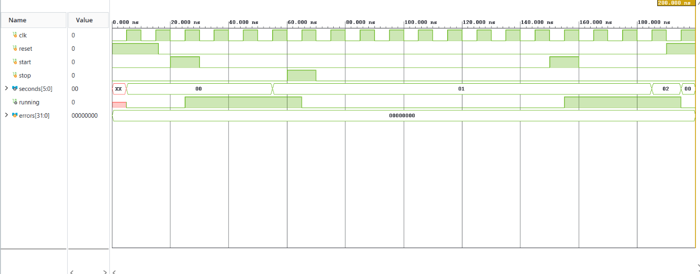
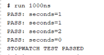
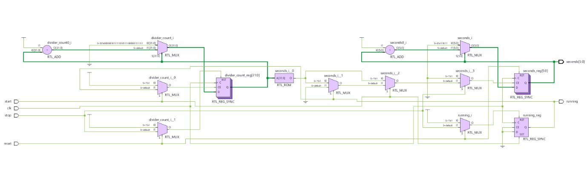

# Digital Stopwatch

The `digital_stopwatch` module is a synthesizable, parameterized digital timer and elapsed-time controller implemented in Verilog HDL (IEEE 1364-2001). Featuring a parameterized clock prescaler (`CLOCK_FREQ_HZ`), start/stop command gating, and a 6-bit modulo-60 seconds counter (`seconds[5:0]`), the module provides precision elapsed-time measurement for instrumentation, embedded SoC timers, and digital clock peripherals across FPGA and ASIC fabrics.

## File Header

```text
// File name   : digital_stopwatch.v
// Title       : Digital Stopwatch
// Project     : Verilog Works
// Created     : 2026-11-17
// Description : Synthesizable digital stopwatch with parameterized clock prescaler and start/stop control
```

## Overview

Hardware timers and stopwatch circuits convert high-frequency system oscillator clocks down to calibrated human-scale time intervals. This design integrates an internal 32-bit integer frequency prescaler counter (`divider_count`) alongside a 6-bit modulo-60 seconds accumulator (`seconds`).

Synchronous control lines provide clean operational sequencing: a `start` pulse initiates time accumulation and sets the `running` status flag high; a `stop` pulse freezes the seconds accumulator and clears the sub-second prescaler; and a synchronous `reset` forces both counters and status flags to zero.

### Digital Design Principles Utilized

- **Configurable Clock Prescaling**: High-resolution 32-bit integer divider parameterized by `CLOCK_FREQ_HZ` (default 50 MHz) to generate 1 Hz tick strobes without dedicated external phase-locked loops (PLLs).
- **Hierarchical Counter Topology**: Sub-second integer prescaler cascaded into a 6-bit modulo-60 base-60 seconds accumulator.
- **Priority-Driven Control Hierarchy**: Evaluates control inputs on the rising clock edge with explicit precedence: `reset` &gt; `stop` &gt; `start` &gt; `running`.
- **Elapsed-Time Hold Preservation**: Stopping the timer freezes the recorded seconds count without clearing it, enabling split-time inspection and resumption.

---

## Features

- **Verilog-2001 Synthesizable RTL**: Standards-compliant, highly portable register-transfer level code.
- **Parameterized Clock Frequency**: Adaptable to any input oscillator frequency via parameter `CLOCK_FREQ_HZ` (default `50000000`).
- **6-Bit Modulo-60 Counter**: Tracks elapsed seconds from 0 to 59 with automated wrap-around.
- **Run/Hold Control Logic**: Dedicated `start` and `stop` handshake inputs with real-time `running` status indicator.
- **Synchronous Reset**: Active-high synchronous clear ensuring deterministic system recovery.
- **Self-Checking Testbench**: Automated testbench with scaled prescaler (`CLOCK_FREQ_HZ = 4`) verifying start, pause/hold, restart, and reset sequences.

---

## Architecture

The module incorporates a synchronous prescaler divider feeding a modulo-60 sequential counter:

```text
                     ┌───────────────────────────────────┐
                     │         digital_stopwatch         │
                     │                                   │
         clk ────────┼─► [Clock Divider (32-bit)]        ├──► running
       reset ────────┼─► (0 to CLOCK_FREQ_HZ - 1)        │
                     │            │ (1 Hz Tick)          │
       start ────────┼─►          ▼                      │
        stop ────────┼─► [Seconds Counter (6-bit)]       ╞════► seconds[5:0]
                     │        (Modulo-60: 0 to 59)       │
                     └───────────────────────────────────┘
```

### Datapath & Control Flow

1. **Clock Prescaler**: While active (`start` or `running`), `divider_count` increments each clock cycle until reaching `CLOCK_FREQ_HZ - 1`, whereupon it resets to `0` and generates an internal 1-cycle enable tick.
2. **Seconds Accumulator**: On each prescaler tick, `seconds` increments by 1. When `seconds == 6'd59`, it rolls over to `6'd0`.
3. **Stop & Pause Action**: When `stop` is asserted, `running` deasserts to `0`, `divider_count` clears to `0`, and `seconds` retains its current registered value.
4. **Synchronous Clear**: When `reset` is asserted, all internal registers and outputs clear to zero.

---

## Module Hierarchy

| Module Name | Type | Purpose | Source File |
|-------------|------|---------|-------------|
| `digital_stopwatch` | Top / DUT | Synthesizable parameterized digital stopwatch RTL | [`digital_stopwatch.v`](digital_stopwatch.v) |
| `tb_digital_stopwatch` | Testbench | Verification harness and self-checking stimulus | [`tb_digital_stopwatch.v`](tb_digital_stopwatch.v) |

---

## Interface (Ports & Parameters)

### Parameters

| Parameter | Type | Default Value | Description |
|-----------|------|---------------|-------------|
| `CLOCK_FREQ_HZ` | `integer` | `50000000` | Input clock frequency in Hz (50 MHz default) |

### Port List

| Port | Direction | Width | Type | Polarity / Trigger | Description |
|------|-----------|-------|------|--------------------|-------------|
| `clk` | Input | `1` | `wire` | Positive Edge | Master system clock |
| `reset` | Input | `1` | `wire` | Active-High | Synchronous reset to clear all counters and flags |
| `start` | Input | `1` | `wire` | Active-High | Start command trigger to enable counting |
| `stop` | Input | `1` | `wire` | Active-High | Stop command trigger to pause timer and hold seconds |
| `seconds` | Output | `6` | `reg` | Clocked (`clk`) | Registered 6-bit elapsed seconds output (0–59) |
| `running` | Output | `1` | `reg` | Clocked (`clk`) | Status flag asserting high while stopwatch is active |

---

## RTL Implementation Details

### Sequential Logic & Priority Hierarchy

The sequential state update occurs within a single `always @(posedge clk)` block:

```verilog
always @(posedge clk) begin
    if (reset) begin
        divider_count <= 0;
        seconds <= 0;
        running <= 1'b0;
    end else begin
        if (stop) begin
            running <= 1'b0;
            divider_count <= 0;
        end else if (start) begin
            running <= 1'b1;
            if (divider_count == CLOCK_FREQ_HZ - 1) begin
                divider_count <= 0;
                if (seconds == 6'd59)
                    seconds <= 0;
                else
                    seconds <= seconds + 1'b1;
            end else begin
                divider_count <= divider_count + 1'b1;
            end
        end else if (running) begin
            if (divider_count == CLOCK_FREQ_HZ - 1) begin
                divider_count <= 0;
                if (seconds == 6'd59)
                    seconds <= 0;
                else
                    seconds <= seconds + 1'b1;
            end else begin
                divider_count <= divider_count + 1'b1;
            end
        end
    end
end
```

### Assignment Discipline & State Retention

- Non-blocking assignments (`<=`) are used exclusively for all sequential state registers.
- When none of `reset`, `stop`, `start`, or `running` are asserted, the sequential block naturally preserves register values, maintaining timing hold integrity without latch generation.

---

## Verification

The testbench [`tb_digital_stopwatch.v`](tb_digital_stopwatch.v) configures a scaled prescaler (`CLOCK_FREQ_HZ = 4`) to accelerate functional verification in simulation:

### Verification Test Steps

1. **Synchronous Reset**: Applies 2 clock cycles of `reset = 1`, verifying `seconds == 0` and `running == 0`.
2. **Start & Counting**: Asserts `start = 1` for one clock cycle. Monitors prescaler countdown over 4 clock cycles and verifies `seconds` advances from 0 to 1.
3. **Stop & Freeze**: Asserts `stop = 1` for one clock cycle. Monitors design over 8 continuous clock cycles and verifies `seconds` remains frozen at `1` with `running == 0`.
4. **Resumption**: Re-asserts `start = 1`. Monitors prescaler countdown over 4 clock cycles and verifies `seconds` advances from 1 to 2.
5. **Reset During Run**: Asserts `reset = 1` and verifies immediate synchronous clearance to `0`.

### Automated Verification Task

```verilog
task check_seconds;
    input [5:0] expected;
    begin
        if (seconds !== expected) begin
            $display("FAIL: seconds=%0d expected=%0d", seconds, expected);
            errors = errors + 1;
        end else begin
            $display("PASS: seconds=%0d", seconds);
        end
    end
endtask
```

---

## Simulation Results

### Timing Waveforms



*Figure 1: Behavioral simulation waveform captured in AMD Vivado Simulator showing start pulse assertion, prescaler countdown, seconds counter increment, stop freeze, resumption, and synchronous reset.*

### Console Verification Logs



*Figure 2: Simulator console output demonstrating automated verification of seconds counting, hold state preservation, and zero-error `STOPWATCH TEST PASSED` completion.*

---

## Schematics

### Elaborated RTL Schematic



*Figure 3: AMD Vivado elaborated design schematic showing the 32-bit prescaler comparator, the 6-bit modulo-60 incrementer, and synchronous register flip-flop banks.*

---

## How to Run Simulation

### Using Icarus Verilog (iverilog)

```bash
# Compile design and testbench
iverilog -g2001 -o stopwatch_sim.out digital_stopwatch.v tb_digital_stopwatch.v

# Execute simulation
vvp stopwatch_sim.out
```

### Using AMD Vivado (xsim batch mode)

```bash
# Analyze Verilog sources
xvlog digital_stopwatch.v tb_digital_stopwatch.v

# Elaborate testbench snapshot
xelab tb_digital_stopwatch -s stopwatch_snapshot

# Run simulation to completion
xsim stopwatch_snapshot -R
```

---

## Technologies

- **Hardware Description Language**: Verilog HDL (IEEE 1364-2001)
- **Design Pattern**: Synchronous Prescaled Modulo Counter
- **EDA & Synthesis Suite**: AMD Vivado Design Suite
- **Logic Simulator**: AMD Vivado Simulator (XSim) / Icarus Verilog
- **Target Technology**: FPGA / ASIC-oriented sequential datapath

---

## Contributing

Contributions focusing on fractional millisecond counter extensions, 7-segment display BCD decoders, or split/lap memory buffers are welcome:

1. Fork the repository
2. Create a feature branch (`git checkout -b feature/split-lap-timer`)
3. Commit your changes
4. Verify simulation passes with 0 errors
5. Submit a Pull Request

---

&copy; Chethan Aithal. All rights reserved.

## Author

**Chethan Aithal**
