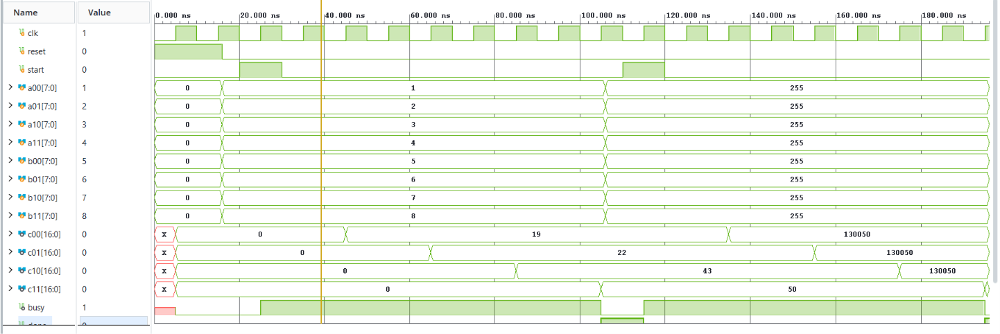
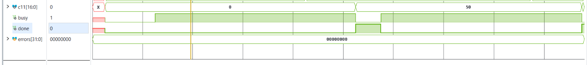
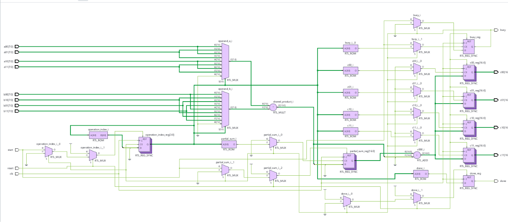

# 2x2 Matrix Multiplier with Shared Multiplier Datapath

The `matrix_multiplier_2x2_shared` module is a synthesizable, area-optimized $2 \times 2$ matrix multiplier implemented in Verilog HDL (IEEE 1364-2001). Engineered for resource-constrained FPGA and ASIC DSP datapaths, it computes the matrix product of two $2 \times 2$ matrices with 8-bit unsigned integer elements ($A \times B = C$). Rather than deploying 8 dedicated parallel hardware multipliers, the architecture time-multiplexes a single 8-bit $\times$ 8-bit multiplier core across an 8-state sequential accumulator, completing the full 4-element matrix multiplication in 8 clock cycles with full 17-bit non-overflow precision.

## File Header

```text
// File name   : matrix_multiplier_2x2_shared.v
// Title       : 2x2 Matrix Multiplier with Shared Multiplier Datapath
// Project     : Verilog Works
// Created     : 2026-11-17
// Description : Synthesizable 2x2 matrix multiplier using a time-multiplexed shared hardware multiplier
```

## Overview

Matrix multiplication is a cornerstone operation in linear algebra, computer graphics, digital beamforming, and neural network inference acceleration. For two $2 \times 2$ matrices:

$$\begin{pmatrix} c_{00} & c_{01} \\ c_{10} & c_{11} \end{pmatrix} = \begin{pmatrix} a_{00} & a_{01} \\ a_{10} & a_{11} \end{pmatrix} \times \begin{pmatrix} b_{00} & b_{01} \\ b_{10} & b_{11} \end{pmatrix}$$

Each resulting matrix element requires two products and one addition:
- $c_{00} = a_{00} \cdot b_{00} + a_{01} \cdot b_{10}$
- $c_{01} = a_{00} \cdot b_{01} + a_{01} \cdot b_{11}$
- $c_{10} = a_{10} \cdot b_{00} + a_{11} \cdot b_{10}$
- $c_{11} = a_{10} \cdot b_{01} + a_{11} \cdot b_{11}$

A brute-force combinational implementation requires 8 multipliers and 4 adders, consuming excessive silicon area and DSP slices. This design optimizes hardware resource utilization by scheduling multiplications across 8 consecutive clock cycles using a single shared multiplier (`shared_product = operand_a * operand_b`) and a 17-bit partial sum accumulator.

### Digital Design Principles Utilized

- **Time-Multiplexed Hardware Sharing**: Reduces multiplier hardware footprint by 87.5% (from 8 multipliers to 1) via sequential operand multiplexing.
- **Precision Dynamic Range Sizing**: Computes 8-bit $\times$ 8-bit products ($255 \times 255 = 65,025$, requiring 16 bits) and sums two products ($65,025 + 65,025 = 130,050$, requiring 17 bits), exactly matching output bus widths (`[16:0]`) with zero arithmetic truncation.
- **Synchronous Handshake Interface**: Utilizes standard `start`, `busy`, and `done` handshaking for clean host processor interfacing.
- **Defensive Combinational Steering**: A fully enumerated 8-entry multiplexer selects active operand pairs with an explicit `default` fallback, eliminating transparent latches.

---

## Features

- **Verilog-2001 Synthesizable RTL**: Standards-compliant, highly portable register-transfer level code.
- **Area-Optimized Architecture**: Single hardware multiplier reused across 8 scheduled calculation cycles.
- **17-Bit Full Precision Output**: Guarantees zero arithmetic overflow across the full dynamic input range ($0$ to $255$).
- **Standard Handshaking Protocol**: `start` trigger, `busy` status indicator, and single-cycle `done` completion strobe.
- **Self-Checking Testbench**: Verification environment validating arbitrary integers and maximum dynamic range boundary saturation vectors ($255 \times 255$).

---

## Architecture

The datapath comprises dual 8-to-1 operand multiplexers, a single shared multiplier, an intermediate partial product register, and a 4-channel matrix element register bank:

```text
                     ┌────────────────────────────────────────────────────────┐
                     │              matrix_multiplier_2x2_shared              │
                     │                                                        │
  a00..a11[7:0] ═════╡► [Operand A MUX (8:1)]                                 │
                     │            │                                           │
  b00..b11[7:0] ═════╡► [Operand B MUX (8:1)]                                 │
                     │            │                                           │
                     │            ▼                                           │
                     │   [Shared 8x8 Multiplier] ──► shared_product[15:0]     │
                     │            │                                           │
                     │            ▼                                           │
                     │   [17-Bit Accumulator]                                 ╞════► c00..c11[16:0]
                     │            │                                           │
        clk, reset ──┼─► [Sequential Controller] ──► operation_index[3:0]     ├──► busy
             start ──┼─► (Cycles 0 to 7 FSM)                                  ├──► done
                     └────────────────────────────────────────────────────────┘
```

### Operation Scheduling Table

| Cycle (`operation_index`) | Active `operand_a` | Active `operand_b` | Computed Action | Destination Register |
|---------------------------|-------------------|-------------------|-----------------|----------------------|
| `4'd0` | `a00` | `b00` | `partial_sum <= shared_product` | `partial_sum` |
| `4'd1` | `a01` | `b10` | `c00 <= partial_sum + shared_product` | `c00[16:0]` |
| `4'd2` | `a00` | `b01` | `partial_sum <= shared_product` | `partial_sum` |
| `4'd3` | `a01` | `b11` | `c01 <= partial_sum + shared_product` | `c01[16:0]` |
| `4'd4` | `a10` | `b00` | `partial_sum <= shared_product` | `partial_sum` |
| `4'd5` | `a11` | `b10` | `c10 <= partial_sum + shared_product` | `c10[16:0]` |
| `4'd6` | `a10` | `b01` | `partial_sum <= shared_product` | `partial_sum` |
| `4'd7` | `a11` | `b11` | `c11 <= partial_sum + shared_product; done <= 1` | `c11[16:0]` |

---

## Module Hierarchy

| Module Name | Type | Purpose | Source File |
|-------------|------|---------|-------------|
| `matrix_multiplier_2x2_shared` | Top / DUT | Synthesizable 2x2 matrix multiplier with shared multiplier datapath | [`matrix_multiplier_2x2_shared.v`](matrix_multiplier_2x2_shared.v) |
| `tb_matrix_multiplier_2x2` | Testbench | Verification harness and self-checking stimulus | [`tb_matrix_multiplier_2x2.v`](tb_matrix_multiplier_2x2.v) |

---

## Interface (Ports & Parameters)

### Port List

| Port | Direction | Width | Type | Polarity / Trigger | Description |
|------|-----------|-------|------|--------------------|-------------|
| `clk` | Input | `1` | `wire` | Positive Edge | Master system clock |
| `reset` | Input | `1` | `wire` | Active-High | Synchronous reset to clear registers and flags |
| `start` | Input | `1` | `wire` | Active-High | 1-cycle trigger initiating matrix multiplication |
| `a00`, `a01` | Input | `8` | `wire` | Level | Matrix A row 0 elements ($A_{00}, A_{01}$) |
| `a10`, `a11` | Input | `8` | `wire` | Level | Matrix A row 1 elements ($A_{10}, A_{11}$) |
| `b00`, `b01` | Input | `8` | `wire` | Level | Matrix B row 0 elements ($B_{00}, B_{01}$) |
| `b10`, `b11` | Input | `8` | `wire` | Level | Matrix B row 1 elements ($B_{10}, B_{11}$) |
| `c00`, `c01` | Output | `17` | `reg` | Clocked (`clk`) | Result matrix C row 0 elements ($C_{00}, C_{01}$) |
| `c10`, `c11` | Output | `17` | `reg` | Clocked (`clk`) | Result matrix C row 1 elements ($C_{10}, C_{11}$) |
| `busy` | Output | `1` | `reg` | Active-High | Asserted while 8-cycle computation is in progress |
| `done` | Output | `1` | `reg` | Active-High | 1-cycle completion pulse indicating valid output data |

---

## RTL Implementation Details

### Combinational Multiplier & Operand Steering

The single hardware multiplier evaluates continuously on selected inputs:

```verilog
assign shared_product = operand_a * operand_b;

always @(*) begin
    operand_a = 8'd0;
    operand_b = 8'd0;
    case (operation_index)
        4'd0: begin operand_a = a00; operand_b = b00; end
        4'd1: begin operand_a = a01; operand_b = b10; end
        4'd2: begin operand_a = a00; operand_b = b01; end
        4'd3: begin operand_a = a01; operand_b = b11; end
        4'd4: begin operand_a = a10; operand_b = b00; end
        4'd5: begin operand_a = a11; operand_b = b10; end
        4'd6: begin operand_a = a10; operand_b = b01; end
        4'd7: begin operand_a = a11; operand_b = b11; end
        default: begin operand_a = 8'd0; operand_b = 8'd0; end
    endcase
end
```

### Sequential Accumulation & Handshake Control

The sequential process advances the state index and accumulates the product pairs:

```verilog
always @(posedge clk) begin
    if (reset) begin
        operation_index <= 0;
        partial_sum <= 0;
        c00 <= 0; c01 <= 0; c10 <= 0; c11 <= 0;
        busy <= 1'b0;
        done <= 1'b0;
    end else begin
        done <= 1'b0;
        if (!busy) begin
            if (start) begin
                operation_index <= 0;
                partial_sum <= 0;
                busy <= 1'b1;
            end
        end else begin
            case (operation_index)
                4'd0: begin
                    partial_sum <= {1'b0, shared_product};
                    operation_index <= 4'd1;
                end
                4'd1: begin
                    c00 <= partial_sum + {1'b0, shared_product};
                    operation_index <= 4'd2;
                end
                // ... repeated for c01, c10, and c11 ...
                4'd7: begin
                    c11 <= partial_sum + {1'b0, shared_product};
                    operation_index <= 0;
                    busy <= 1'b0;
                    done <= 1'b1;
                end
            endcase
        end
    end
end
```

---

## Verification

The testbench [`tb_matrix_multiplier_2x2.v`](tb_matrix_multiplier_2x2.v) implements a self-checking verification harness with automated handshaking and output assertions.

### Test Stimulus & Coverage

1. **Standard Integer Matrix Multiplication**:
   $$A = \begin{pmatrix} 1 & 2 \\ 3 & 4 \end{pmatrix}, \quad B = \begin{pmatrix} 5 & 6 \\ 7 & 8 \end{pmatrix}$$
   - $C_{00} = (1 \times 5) + (2 \times 7) = 5 + 14 = 19$
   - $C_{01} = (1 \times 6) + (2 \times 8) = 6 + 16 = 22$
   - $C_{10} = (3 \times 5) + (4 \times 7) = 15 + 28 = 43$
   - $C_{11} = (3 \times 6) + (4 \times 8) = 18 + 32 = 50$
   - **Verification**: `check_outputs(17'd19, 17'd22, 17'd43, 17'd50)` passes with zero errors.

2. **Maximum Dynamic Range Stress Case**:
   $$A = \begin{pmatrix} 255 & 255 \\ 255 & 255 \end{pmatrix}, \quad B = \begin{pmatrix} 255 & 255 \\ 255 & 255 \end{pmatrix}$$
   - $C_{ij} = (255 \times 255) + (255 \times 255) = 65,025 + 65,025 = 130,050$
   - **Verification**: `check_outputs(17'd130050, 17'd130050, 17'd130050, 17'd130050)` passes, verifying full 17-bit accumulator precision without saturation or overflow errors.

---

## Simulation Results

### Timing Waveforms

#### Full Simulation Overview



*Figure 1: Behavioral simulation waveform captured in AMD Vivado Simulator showing input matrix drives, 8-cycle `busy` assertion periods, progressive element computation, and final result latching for both test vectors.*

#### Handshake & Flag Timing Detail



*Figure 2: Waveform detail illustrating synchronous `done` strobe assertion upon calculation completion, clean deassertion of `busy`, and zero error count (`errors = 0`).*

---

## Schematics

### Elaborated RTL Schematic



*Figure 3: AMD Vivado elaborated design schematic showing the dual 8:1 operand multiplexers, the centralized `RTL_MULT` core, the `RTL_ADD` accumulator, and output register banks (`c00`–`c11`, `busy`, `done`).*

---

## How to Run Simulation

### Using Icarus Verilog (iverilog)

```bash
# Compile design and testbench
iverilog -g2001 -o matrix_multiplier_sim.out matrix_multiplier_2x2_shared.v tb_matrix_multiplier_2x2.v

# Execute simulation
vvp matrix_multiplier_sim.out
```

### Using AMD Vivado (xsim batch mode)

```bash
# Analyze Verilog sources
xvlog matrix_multiplier_2x2_shared.v tb_matrix_multiplier_2x2.v

# Elaborate testbench snapshot
xelab tb_matrix_multiplier_2x2 -s matrix_multiplier_snapshot

# Run simulation to completion
xsim matrix_multiplier_snapshot -R
```

---

## Technologies

- **Hardware Description Language**: Verilog HDL (IEEE 1364-2001)
- **Architecture**: Time-Multiplexed Shared DSP Multiplier Datapath
- **EDA & Synthesis Suite**: AMD Vivado Design Suite
- **Logic Simulator**: AMD Vivado Simulator (XSim) / Icarus Verilog
- **Target Technology**: FPGA / ASIC DSP datapaths

---

## Contributing

Contributions focusing on parameterized matrix dimensions ($N \times N$), signed two's complement arithmetic, fixed-point representations, or systolic array architectures are welcome:

1. Fork the repository
2. Create a feature branch (`git checkout -b feature/signed-matrix-mult`)
3. Commit your changes
4. Verify simulation passes with 0 errors
5. Submit a Pull Request

---

&copy; Chethan Aithal. All rights reserved.

## Author

**Chethan Aithal**
