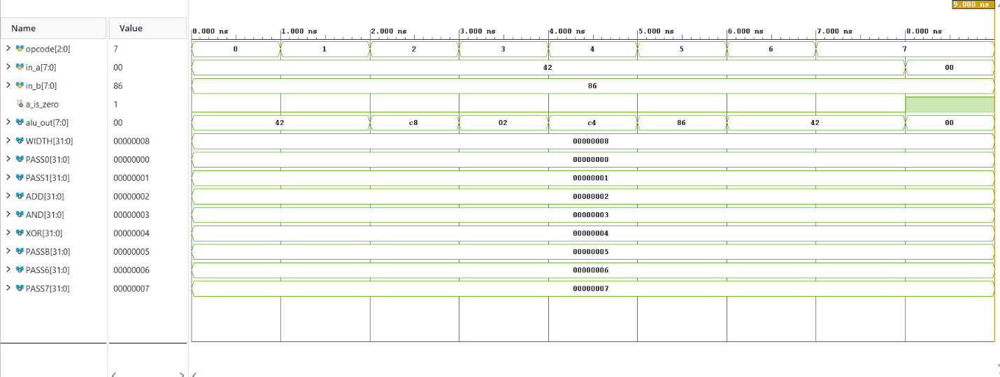
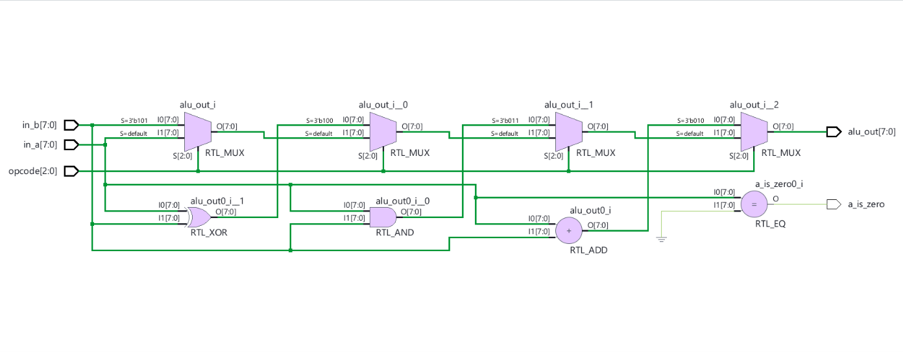
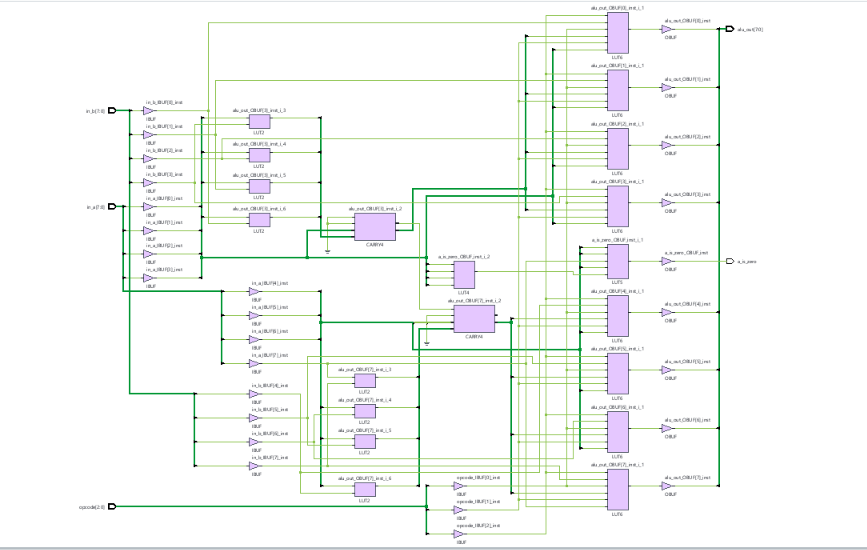

# Parameterized ALU

The `alu` module is a fully synthesizable, parameterized $N$-bit Arithmetic Logic Unit (ALU) implemented in Verilog HDL (IEEE 1364-2001). Designed for execution and datapath stages in RISC-V processor architectures, it executes unsigned/two's-complement addition, bitwise boolean operations (`AND`, `XOR`), direct operand passthroughs, and zero-condition detection based on a 3-bit instruction opcode (`opcode`). Its purely combinational architecture guarantees single-cycle execution with zero inferred latches, mapping efficiently to dedicated FPGA carry chains (`CARRY4`) and multi-input Look-Up Tables (`LUT6`).

## File Header

```text
// File name   : alu.v
// Title       : Parameterized ALU
// Project     : Verilog Works
// Created     : 2026-10-18
// Description : Synthesizable parameterized N-bit Arithmetic Logic Unit with zero flag generation
```

## Overview

In microprocessors and digital signal processing cores, the Arithmetic Logic Unit serves as the primary computational datapath element, executing integer calculations and control flag evaluations required for conditional branching and program counter redirection.

This module provides parameterized width scaling (`WIDTH`, defaulting to 8 bits) and evaluates operational instructions in a single combinational evaluation step. In addition to standard arithmetic and logic operations, the ALU computes an active-high zero indicator flag (`a_is_zero`), which directly facilitates branch-if-equal-to-zero (`BEQZ`) and branch-if-not-equal-to-zero (`BNEZ`) instructions in RISC architectures.

### Digital Design Principles Utilized

- **Arithmetic & Fast Carry Logic**: Implements addition using hardware carry-propagate logic, inferring dedicated silicon carry chains (`CARRY4`) in FPGA targets.
- **Bitwise Logic Operations**: Independent bit-slice evaluation for bitwise conjunction (`AND`) and disjunction (`XOR`).
- **Comparator & Flag Generation**: Wide zero-equality comparison (`in_a == 0`) evaluated in parallel with computational results.
- **Hardware Parameterization**: Configurable bit width (`WIDTH`) supports seamless scaling across 8-bit, 16-bit, 32-bit, or 64-bit datapaths without altering RTL control structures.
- **Defensive Combinational Coding**: Purely combinational evaluation using `always @*` and complete conditional coverage eliminates transparent latch inference.

---

## Features

- **Verilog-2001 Synthesizable RTL**: Standards-compliant, highly portable register-transfer level code.
- **Parameterized Data Width**: Scalable `WIDTH` parameter (default `8`, adaptable to 32-bit RISC-V architectures).
- **Multi-Operation Datapath**: Supports addition (`ADD`), bitwise `AND`, bitwise `XOR`, and operand bypass modes (`PASSB`, `PASS0`-`PASS7`).
- **Dedicated Branch Flag**: Evaluates `a_is_zero` in parallel with datapath execution for zero-latency branch condition testing.
- **Optimized FPGA Resource Utilization**: Synthesizes directly into cascaded `CARRY4` primitives, `LUT2` carry-generation cells, and `LUT6` operand multiplexers.
- **Zero Inferred Latches**: Fully specified control paths ensure 100% combinational synthesis.
- **Self-Checking Testbench**: Automated verification suite validating arithmetic accuracy, logical correctness, and flag assertion.

---

## Architecture

The module takes two parallel operands (`in_a`, `in_b`) and an operational selector (`opcode`). The internal decoding logic routes the selected computation directly to `alu_out`, while a parallel comparator evaluates whether operand A is zero.

```text
                        ┌───────────────────────────────────┐
                        │                alu                │
                        │          (WIDTH-bit ALU)          │
                        │                                   │
      in_a[WIDTH-1:0] ══╡═══════════════════════════════════╪════► a_is_zero
                        │   ┌─────────┐   ┌─────────┐       │     (in_a == 0)
      in_b[WIDTH-1:0] ══╡══►│ RTL_ADD │   │ Bitwise │       │
                        │   │ (CARRY) │   │ AND/XOR │       │
                        │   └────┬────┘   └───┬─────┘       │
                        │        └──────┬─────┘             ╞════► alu_out[WIDTH-1:0]
                        │               ▼                   │
       opcode[2:0] ─────┼──────► [Opcode Decoder]           │
                        └───────────────────────────────────┘
```

### Datapath & Control Flow

1. **Inputs**: Operands `in_a[WIDTH-1:0]`, `in_b[WIDTH-1:0]`, and the 3-bit control field `opcode[2:0]` enter the module boundary.
2. **Comparator Stage**: Evaluates `in_a == 0` continuously and drives the single-bit status flag `a_is_zero`.
3. **Arithmetic & Logic Evaluation**: In parallel, the adder, bitwise AND, and bitwise XOR networks evaluate against `in_a` and `in_b`.
4. **Multiplexing Stage**: The operational opcode selects the active functional output or bypass channel.
5. **Outputs**: Driven combinationally onto `alu_out[WIDTH-1:0]`.

---

## Module Hierarchy

| Module Name | Type | Purpose | Source File |
|-------------|------|---------|-------------|
| `alu` | Top / DUT | Synthesizable parameterized Arithmetic Logic Unit | [`alu.v`](alu.v) |
| `alu_test` | Testbench | Verification harness and self-checking stimulus | [`alu_test.v`](alu_test.v) |

---

## Interface (Ports & Parameters)

### Parameters

| Parameter | Type | Default Value | Description |
|-----------|------|---------------|-------------|
| `WIDTH` | `integer` | `8` | Bit width of operand buses (`in_a`, `in_b`) and result bus (`alu_out`) |

### Port List

| Port | Direction | Width | Type | Polarity / Trigger | Description |
|------|-----------|-------|------|--------------------|-------------|
| `opcode` | Input | `3` | `wire` | Level | 3-bit operational instruction code |
| `in_a` | Input | `WIDTH` | `wire` | Level | Primary operand input bus A |
| `in_b` | Input | `WIDTH` | `wire` | Level | Secondary operand input bus B |
| `a_is_zero` | Output | `1` | `reg` | Level (Combinational) | Active-high flag asserted when `in_a == 0` |
| `alu_out` | Output | `WIDTH` | `reg` | Level (Combinational) | Computed arithmetic or logical output bus |

---

## Opcode Decoding Table

| Opcode (`[2:0]`) | Mnemonic | Operation | Description |
|------------------|----------|-----------|-------------|
| `3'b000` (`0`) | `PASS0` | `alu_out = in_a` | Passthrough operand A |
| `3'b001` (`1`) | `PASS1` | `alu_out = in_a` | Passthrough operand A |
| `3'b010` (`2`) | `ADD` | `alu_out = in_a + in_b` | Integer addition |
| `3'b011` (`3`) | `AND` | `alu_out = in_a & in_b` | Bitwise logical AND |
| `3'b100` (`4`) | `XOR` | `alu_out = in_a ^ in_b` | Bitwise logical XOR |
| `3'b101` (`5`) | `PASSB` | `alu_out = in_b` | Passthrough operand B |
| `3'b110` (`6`) | `PASS6` | `alu_out = in_a` | Passthrough operand A |
| `3'b111` (`7`) | `PASS7` | `alu_out = in_a` | Passthrough operand A |

---

## RTL Implementation Details

### Sequential vs. Combinational Separation

The design is modeled using a single combinational `always @*` block (IEEE 1364-2001 implicit sensitivity list) that re-evaluates immediately whenever `opcode`, `in_a`, or `in_b` changes:

```verilog
always @* begin
    a_is_zero = (in_a == 0);
    if (opcode == ADD) 
        alu_out = in_a + in_b; 
    else if (opcode == AND) 
        alu_out = in_a & in_b; 
    else if (opcode == XOR) 
        alu_out = in_a ^ in_b; 
    else if (opcode == PASSB) 
        alu_out = in_b; 
    else
        alu_out = in_a;
end
```

### Assignment Discipline

- Blocking assignments (`=`) are used exclusively inside the combinational procedural block, preventing scheduling races and ensuring immediate dataflow propagation.

### Defensive Coding & Latch Prevention

- `a_is_zero` is evaluated unconditionally at the beginning of the block, ensuring it is driven under all possible operational conditions.
- The `if-else` decoding chain concludes with a default `else alu_out = in_a;` fallback, ensuring all unmapped opcodes (`0`, `1`, `6`, `7`) produce a valid, deterministic output and preventing unintended latch inference.

---

## Verification

The verification environment is implemented in [`alu_test.v`](alu_test.v) as an automated self-checking testbench.

### Test Stimulus & Coverage

The testbench initializes test vectors (`in_a = 8'h42`, `in_b = 8'h86`) and evaluates every opcode sequentially at 1 ns increments:

1. **`PASS0` (Opcode 0)**: Verifies `alu_out == 8'h42` and `a_is_zero == 1'b0`.
2. **`PASS1` (Opcode 1)**: Verifies `alu_out == 8'h42` and `a_is_zero == 1'b0`.
3. **`ADD` (Opcode 2)**: Computes `8'h42 + 8'h86 = 8'hC8` (66 + 134 = 200).
4. **`AND` (Opcode 3)**: Computes `8'h42 & 8'h86 = 8'h02` (`01000010b & 10000110b = 00000010b`).
5. **`XOR` (Opcode 4)**: Computes `8'h42 ^ 8'h86 = 8'hC4` (`01000010b ^ 10000110b = 11000100b`).
6. **`PASSB` (Opcode 5)**: Routes operand B directly, verifying `alu_out == 8'h86`.
7. **`PASS6` (Opcode 6)**: Verifies `alu_out == 8'h42`.
8. **`PASS7` (Opcode 7)**: Verifies `alu_out == 8'h42`.
9. **Zero Flag Corner Case**: Applies `in_a = 8'h00` with `opcode = PASS7`, confirming `a_is_zero` asserts to `1'b1` and `alu_out == 8'h00`.

### Monitoring & Self-Checking Task

```verilog
task expect;
    input exp_zero;
    input [WIDTH-1:0] exp_out;
    if (a_is_zero !== exp_zero || alu_out !== exp_out) begin
        $display("TEST FAILED");
        $display("At time %0d opcode=%b in_a=%b in_b=%b a_is_zero=%b alu_out=%b",
            $time, opcode, in_a, in_b, a_is_zero, alu_out);
        if (a_is_zero !== exp_zero)
            $display("a_is_zero should be %b", exp_zero);
        if (alu_out !== exp_out)
            $display("alu_out should be %b", exp_out);
        $finish;
    end
    else begin
        $display("At time %0d opcode=%b in_a=%b in_b=%b a_is_zero=%b alu_out=%b",
            $time, opcode, in_a, in_b, a_is_zero, alu_out);
    end
endtask
```

---

## Simulation Results

### Timing Waveforms



*Figure 1: Behavioral simulation waveform demonstrating opcode sweeps from 0 to 7, correct arithmetic addition (`C8h`), bitwise operations (`02h`, `C4h`), and zero-flag assertion (`a_is_zero = 1`) at 8.0 ns.*

### Console Verification Logs

```text
Time resolution is 1 ps
At time 1 opcode=000 in_a=01000010 in_b=10000110 a_is_zero=0 alu_out=01000010
At time 2 opcode=001 in_a=01000010 in_b=10000110 a_is_zero=0 alu_out=01000010
At time 3 opcode=010 in_a=01000010 in_b=10000110 a_is_zero=0 alu_out=11001000
At time 4 opcode=011 in_a=01000010 in_b=10000110 a_is_zero=0 alu_out=00000010
At time 5 opcode=100 in_a=01000010 in_b=10000110 a_is_zero=0 alu_out=11000100
At time 6 opcode=101 in_a=01000010 in_b=10000110 a_is_zero=0 alu_out=10000110
At time 7 opcode=110 in_a=01000010 in_b=10000110 a_is_zero=0 alu_out=01000010
At time 8 opcode=111 in_a=01000010 in_b=10000110 a_is_zero=0 alu_out=01000010
At time 9 opcode=111 in_a=00000000 in_b=10000110 a_is_zero=1 alu_out=00000000
TEST PASSED
$finish called at time : 9 ns
```

---

## Schematics

### Elaborated RTL Schematic



*Figure 2: AMD Vivado elaborated design schematic highlighting the parallel functional units (`RTL_ADD`, `RTL_AND`, `RTL_XOR`), zero-equality comparator (`RTL_EQ`), and priority multiplexer decoding tree.*

### Synthesized Gate-Level Design



*Figure 3: Post-synthesis technology schematic targeting FPGA fabric, illustrating mapping to dual cascaded `CARRY4` fast-carry lookahead primitives, `LUT2` carry generators, and `LUT6` result selection multiplexers with 0 flip-flops and 0 latches.*

---

## How to Run Simulation

### Using Icarus Verilog (iverilog)

```bash
# Compile design and testbench
iverilog -g2001 -o alu_sim.out alu.v alu_test.v

# Execute simulation
vvp alu_sim.out
```

### Using AMD Vivado (xsim batch mode)

```bash
# Analyze Verilog sources
xvlog alu.v alu_test.v

# Elaborate testbench snapshot
xelab alu_test -s alu_snapshot

# Run simulation to completion
xsim alu_snapshot -R
```

---

## Technologies

- **Hardware Description Language**: Verilog HDL (IEEE 1364-2001)
- **RTL Synthesis & Static Timing Analysis**: AMD Vivado Design Suite
- **Logic Simulator**: AMD Vivado Simulator (XSim) / Icarus Verilog
- **Target Technology**: FPGA / ASIC-oriented combinational datapath primitives (`CARRY4`, `LUT6`, `LUT2`)

---

## Contributing

Contributions focusing on parameterization, testbench automation, formal assertions, or FPGA implementation are welcome:

1. Fork the repository
2. Create a feature branch (`git checkout -b feature/improvement`)
3. Commit your changes
4. Verify simulation passes with 0 errors
5. Submit a Pull Request

---

&copy; Chethan Aithal. All rights reserved.

## Author

**Chethan Aithal**
