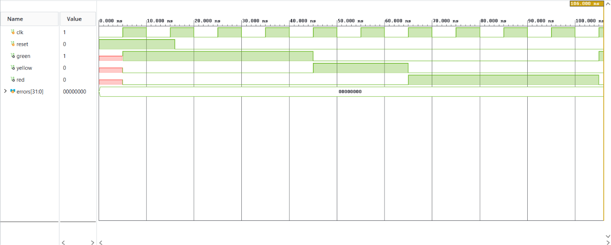
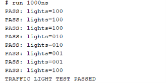
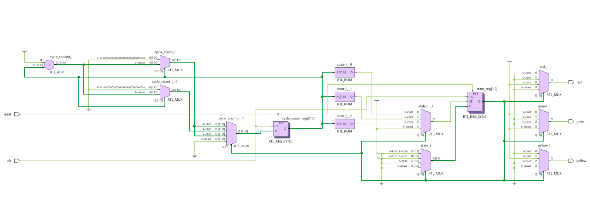
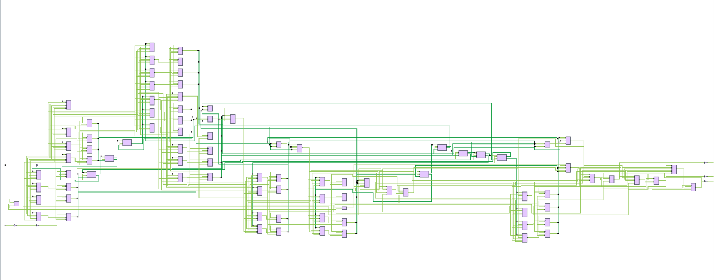

# Parameterized Traffic Light Controller

The `traffic_light_controller` module is a synthesizable, parameterized 3-state Moore Finite State Machine (FSM) implemented in Verilog HDL (IEEE 1364-2001). Designed for automated intersection traffic management, it orchestrates deterministic sequential transitions across Green, Yellow, and Red signal phases using configurable per-state duration counters (`GREEN_CYCLES`, `YELLOW_CYCLES`, `RED_CYCLES`). The architecture cleanly decouples sequential state and duration timing from combinational Moore output decoding, guaranteeing glitch-free signal driving and complete freedom from inferred transparent latches.

## File Header

```text
// File name   : traffic_light_controller.v
// Title       : Parameterized Traffic Light Controller
// Project     : Verilog Works
// Created     : 2026-11-17
// Description : Synthesizable 3-state Moore FSM with parameterized phase timers for traffic management
```

## Overview

Road traffic signalling systems require strict fail-safe sequencing: an active green phase must transition through an intermediate yellow warning period before asserting the red stop phase, looping deterministically without entering illegal concurrent activation states.

This implementation realizes a robust 2-process Moore FSM architecture. A sequential process clocked on `clk` manages state transitions and increments a 32-bit cycle timer (`cycle_count`) against configurable parameters. A companion combinational process evaluates the current state and drives mutually exclusive active-high illumination control signals (`green`, `yellow`, `red`).

### Digital Design Principles Utilized

- **2-Process FSM Methodology**: Separates clocked sequential state/timer tracking (`always @(posedge clk)`) from purely combinational output logic (`always @(*)`).
- **Synchronous Reset Discipline**: An active-high synchronous reset forces the controller into `GREEN_STATE` and zeros the cycle accumulator, avoiding asynchronous metastability hazards.
- **Hardware Parameterization**: Independent cycle timers (`GREEN_CYCLES`, `YELLOW_CYCLES`, `RED_CYCLES`) allow adapting timing to varied clock frequencies and intersection throughput requirements.
- **Mutual Exclusion by Construction**: The output decoder guarantees that only one lamp signal can be asserted high during any single operating cycle.

---

## Features

- **Verilog-2001 Synthesizable RTL**: Standards-compliant, highly portable register-transfer level code.
- **Parameterized Phase Timers**: Fully configurable cycle durations for Green, Yellow, and Red intervals (defaults: 5, 2, 5 cycles).
- **Classic 3-State Moore FSM**: Deterministic state transitions (`GREEN_STATE` &rarr; `YELLOW_STATE` &rarr; `RED_STATE` &rarr; `GREEN_STATE`).
- **Synchronous Reset**: Active-high synchronous clear to a safe, deterministic initial operational state.
- **Zero Latch Inference**: Combinational output decoder initializes all signals low before evaluating state, preventing latch synthesis.
- **Self-Checking Testbench**: Verification environment validating precise cycle-accurate phase durations and state transition boundaries.

---

## Architecture

The controller consists of a synchronous timing/state engine coupled to a combinational lamp decoding matrix:

```text
                     ┌───────────────────────────────────┐
                     │     traffic_light_controller      │
                     │          (Moore FSM)              │
                     │                                   │
         clk ────────┼─► [Timing Accumulator]            ├──► green
                     │            │                      │
       reset ────────┼─► [State Register (2-bit)]        ├──► yellow
                     │            │                      │
                     │   ┌────────▼────────┐             │
                     │   │ Combinational   │             ├──► red
                     │   │ Output Decoder  │             │
                     │   └─────────────────┘             │
                     └───────────────────────────────────┘
```

### State Transition Diagram

```text
       ┌────────┐
       │ RESET  │
       └───┬────┘
           ▼
    ┌─────────────┐   count == GREEN_CYCLES - 1    ┌─────────────┐
    │ GREEN_STATE │ ──────────────────────────────► │ YELLOW_STATE│
    │  (green=1)  │                                │  (yellow=1) │
    └─────────────┘                                └──────┬──────┘
           ▲                                              │ count == YELLOW_CYCLES - 1
           │                                              ▼
           │          count == RED_CYCLES - 1      ┌─────────────┐
           └────────────────────────────────────── │  RED_STATE  │
                                                   │   (red=1)   │
                                                   └─────────────┘
```

---

## Module Hierarchy

| Module Name | Type | Purpose | Source File |
|-------------|------|---------|-------------|
| `traffic_light_controller` | Top / DUT | Synthesizable parameterized traffic light Moore FSM | [`traffic_light_controller.v`](traffic_light_controller.v) |
| `tb_traffic_light_controller` | Testbench | Verification harness and self-checking cycle assertion testbench | [`tb_traffic_light_controller.v`](tb_traffic_light_controller.v) |

---

## Interface (Ports & Parameters)

### Parameters

| Parameter | Type | Default Value | Description |
|-----------|------|---------------|-------------|
| `GREEN_CYCLES` | `integer` | `5` | Active duration of the Green light phase in clock cycles |
| `YELLOW_CYCLES` | `integer` | `2` | Active duration of the Yellow warning phase in clock cycles |
| `RED_CYCLES` | `integer` | `5` | Active duration of the Red stop phase in clock cycles |

### Port List

| Port | Direction | Width | Type | Polarity / Trigger | Description |
|------|-----------|-------|------|--------------------|-------------|
| `clk` | Input | `1` | `wire` | Positive Edge | Master system clock |
| `reset` | Input | `1` | `wire` | Active-High | Synchronous reset to `GREEN_STATE` |
| `green` | Output | `1` | `reg` | Level (Combinational) | Active-high green lamp drive signal |
| `yellow` | Output | `1` | `reg` | Level (Combinational) | Active-high yellow lamp drive signal |
| `red` | Output | `1` | `reg` | Level (Combinational) | Active-high red lamp drive signal |

---

## Finite State Machine Details

### State Encoding

| State Parameter | Binary Code | Active Phase Output | Active Duration Formula |
|-----------------|-------------|---------------------|--------------------------|
| `GREEN_STATE` | `2'b00` | `{green, yellow, red} = 3'b100` | `GREEN_CYCLES` cycles |
| `YELLOW_STATE` | `2'b01` | `{green, yellow, red} = 3'b010` | `YELLOW_CYCLES` cycles |
| `RED_STATE` | `2'b10` | `{green, yellow, red} = 3'b001` | `RED_CYCLES` cycles |
| `default` | — | Safe recovery (`green = 1'b1`) | Resets counter to 0 |

---

## RTL Implementation Details

### Sequential vs. Combinational Separation

The design strictly segregates sequential state transitions from combinational output driving:

1. **Sequential Timer & State Engine (`always @(posedge clk)`)**:
   ```verilog
   always @(posedge clk) begin
       if (reset) begin
           state <= GREEN_STATE;
           cycle_count <= 0;
       end else begin
           case (state)
               GREEN_STATE: begin
                   if (cycle_count == GREEN_CYCLES - 1) begin
                       cycle_count <= 0;
                       state <= YELLOW_STATE;
                   end else begin
                       cycle_count <= cycle_count + 1'b1;
                   end
               end
               // ... YELLOW_STATE and RED_STATE handling ...
           endcase
       end
   end
   ```

2. **Combinational Moore Output Matrix (`always @(*)`)**:
   ```verilog
   always @(*) begin
       green = 1'b0;
       yellow = 1'b0;
       red = 1'b0;
       case (state)
           GREEN_STATE:  green = 1'b1;
           YELLOW_STATE: yellow = 1'b1;
           RED_STATE:    red = 1'b1;
           default:      green = 1'b1;
       endcase
   end
   ```

### Assignment Discipline & Defensive Coding

- Sequential registers (`state`, `cycle_count`) are updated using exclusively non-blocking assignments (`<=`).
- Combinational outputs are assigned using blocking assignments (`=`).
- Default values (`green = 0; yellow = 0; red = 0;`) pre-assign all outputs at the beginning of the combinational block, eliminating any possibility of latch synthesis.

---

## Verification

The testbench [`tb_traffic_light_controller.v`](tb_traffic_light_controller.v) verifies state sequencing and timer boundaries by overriding default parameters to shorter durations: `GREEN_CYCLES = 3`, `YELLOW_CYCLES = 2`, `RED_CYCLES = 4`.

### Verification Sequence

1. **Synchronous Reset**: Holds `reset = 1` for 2 clock periods, asserting `{green, yellow, red} == 3'b100`.
2. **Green Phase**: Deasserts reset and monitors green signal holding active for exactly 3 clock periods.
3. **Yellow Phase**: Verifies transition to `{green, yellow, red} == 3'b010` for exactly 2 clock periods.
4. **Red Phase**: Verifies transition to `{green, yellow, red} == 3'b001` for exactly 4 clock periods.
5. **Phase Recirculation**: Verifies clean wrap-around back to `GREEN_STATE` (`3'b100`).

### Automated Checking Task

```verilog
task check_lights;
    input expected_green;
    input expected_yellow;
    input expected_red;
    begin
        if ({green, yellow, red} !== {expected_green, expected_yellow, expected_red}) begin
            $display("FAIL: lights=%b%b%b expected=%b%b%b", green, yellow, red,
                     expected_green, expected_yellow, expected_red);
            errors = errors + 1;
        end else begin
            $display("PASS: lights=%b%b%b", green, yellow, red);
        end
    end
endtask
```

---

## Simulation Results

### Timing Waveforms



*Figure 1: Behavioral simulation waveform showing clock edges, synchronous reset deassertion, and exact duration cycling through Green, Yellow, and Red states.*

### Console Verification Logs



*Figure 2: Simulator console output displaying cycle-by-cycle light verification with zero mismatches and successful `TRAFFIC LIGHT TEST PASSED` completion.*

---

## Schematics

### Elaborated RTL Schematic



*Figure 3: AMD Vivado elaborated design schematic showing the cycle counter adder, equality comparator logic, FSM state registers, and output decoding multiplexers.*

### Synthesized Gate-Level Design



*Figure 4: Post-synthesis technology schematic targeting FPGA fabric, illustrating mapping to synchronous flip-flops (`FDRE`), look-up tables (`LUT2`, `LUT3`, `LUT6`), and fast carry chains (`CARRY4`).*

---

## How to Run Simulation

### Using Icarus Verilog (iverilog)

```bash
# Compile design and testbench
iverilog -g2001 -o traffic_light_sim.out traffic_light_controller.v tb_traffic_light_controller.v

# Execute simulation
vvp traffic_light_sim.out
```

### Using AMD Vivado (xsim batch mode)

```bash
# Analyze Verilog sources
xvlog traffic_light_controller.v tb_traffic_light_controller.v

# Elaborate testbench snapshot
xelab tb_traffic_light_controller -s traffic_light_snapshot

# Run simulation to completion
xsim traffic_light_snapshot -R
```

---

## Technologies

- **Hardware Description Language**: Verilog HDL (IEEE 1364-2001)
- **Design Pattern**: 2-Process Moore Finite State Machine
- **EDA & Synthesis Suite**: AMD Vivado Design Suite
- **Logic Simulator**: AMD Vivado Simulator (XSim) / Icarus Verilog
- **Target Technology**: FPGA / ASIC-oriented sequential logic (`FDRE`, `LUT`)

---

## Contributing

Contributions focusing on pedestrian push-button crosswalk inputs, emergency vehicle priority preemption, or four-way intersection scaling are welcome:

1. Fork the repository
2. Create a feature branch (`git checkout -b feature/preemption-logic`)
3. Commit your changes
4. Verify simulation passes with 0 errors
5. Submit a Pull Request

---

&copy; Chethan Aithal. All rights reserved.

## Author

**Chethan Aithal**
