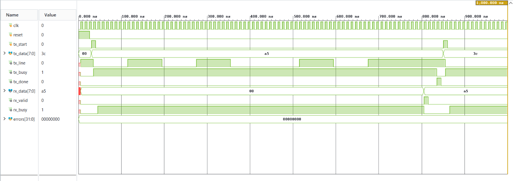
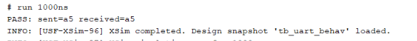
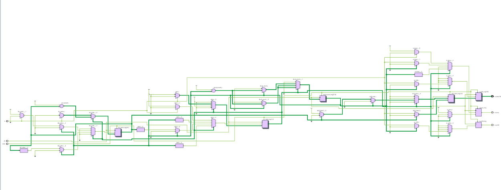

# UART Full-Duplex Transceiver

The `UART_Transceiver` subsystem is a synthesizable, parameterized full-duplex Universal Asynchronous Receiver-Transmitter (UART) core implemented in Verilog HDL (IEEE 1364-2001). Comprising dedicated transmission (`uart_tx`) and reception (`uart_rx`) engines, it supports standard 8-N-1 serial communication (1 start bit, 8 data bits LSB-first, no parity, 1 stop bit, idle-high line). The receiver incorporates midpoint bit-oversampling (`CLKS_PER_BIT / 2`) to ensure noise immunity and phase synchronization across asynchronous clock domains, providing reliable serial communication for FPGA-to-PC interfaces, debug logging, and microcontroller telemetry.

## File Header

```text
// File name   : uart_tx.v, uart_rx.v
// Title       : UART Full-Duplex Transceiver
// Project     : Verilog Works
// Created     : 2026-11-17
// Description : Synthesizable full-duplex UART core with midpoint sampling and parameterized baud generator
```

## Overview

Asynchronous serial communication requires robust clock generation and edge detection because transmitter and receiver operate on unsynchronized local clocks. This design provides modular, parameterizable baud rate control governed by the `CLKS_PER_BIT` parameter.

At the nominal system clock of 50 MHz, setting `CLKS_PER_BIT = 434` configures the core for standard 115,200 baud ($50\text{ MHz} / 115200 \approx 434$). The receiver samples incoming data at the center of each bit period ($T_{\text{bit}} / 2$) to guard against line jitter, rise/fall asymmetries, and clock skew.

### Digital Design Principles Utilized

- **Asynchronous Protocol Serialization**: Converts parallel 8-bit bytes to serial bitstreams framed with low start and high stop bits.
- **Midpoint Bit-Sampling Synchronization**: Detects falling start bit edge in IDLE and samples the midpoint ($CLKS\_PER\_BIT / 2$) to validate start condition before reading data bits.
- **Independent Full-Duplex FSMs**: Transmitter and receiver operate autonomously, allowing concurrent bidirectional transfer without arbitration stalls.
- **Parameterized Baud Generation**: Integer division counter scales communication to any standard baud rate (9600, 19200, 38400, 57600, 115200 baud).

---

## Features

- **Verilog-2001 Synthesizable RTL**: Clean, portable register-transfer level code adhering to IEEE 1364-2001 standards.
- **Standard 8-N-1 Framing**: 1 start bit (`0`), 8 data bits (LSB-first), 1 stop bit (`1`), idle state high (`1`).
- **Midpoint Oversampling Receiver**: Rejects false start-bit glitches by re-evaluating line state at the half-bit period.
- **Parameterized Baud Rate Generator**: `CLKS_PER_BIT` parameter configurable for any clock and baud frequency.
- **Complete Status Handshaking**: Provides `tx_busy`, `tx_done`, `rx_busy`, and `rx_valid` flags for host interface flow control.
- **Self-Checking Loopback Testbench**: Closed-loop verification harness transmitting alternating and boundary test vectors (`8'hA5`, `8'h3C`, `8'h00`, `8'hFF`).

---

## Architecture

The transceiver architecture decouples the transmission datapath from reception, linked via single-wire serial interconnects:

```text
                     ┌───────────────────────────────────┐
                     │          UART Transceiver         │
                     │                                   │
      tx_data[7:0] ══╡► [uart_tx Engine]                 ├──► tx (Serial Out)
          tx_start ──┼─►   FSM & Shift Register          ├──► tx_busy
                     │                                   ├──► tx_done
                     │                                   │
                     │   [uart_rx Engine]                │
   rx (Serial In) ───┼─►   Midpoint Sampler & FSM        ╞════► rx_data[7:0]
                     │                                   ├──► rx_valid
         clk, reset ─┼─► Shared Baud Counters            ├──► rx_busy
                     └───────────────────────────────────┘
```

### Serial Frame Format (8-N-1)

```text
  Line Idle      Start          8 Data Bits (LSB First)          Stop     Line Idle
  (Logic 1)     Bit (0)     D0   D1   D2   D3   D4   D5   D6   D7    Bit (1)   (Logic 1)
 ────────────┐         ┌─── ─── ─── ─── ─── ─── ─── ─── ─── ───┐───────────
             │         │                                        │
             └─────────┴────────────────────────────────────────┘
                       ▲                 ▲
               Midpoint Sample 1       Midpoint Sample 8
```

---

## Module Hierarchy

| Module Name | Type | Purpose | Source File |
|-------------|------|---------|-------------|
| `uart_tx` | Submodule | Synthesizable 8-bit UART serial transmitter | [`uart_tx.v`](uart_tx.v) |
| `uart_rx` | Submodule | Synthesizable 8-bit UART serial receiver with midpoint sampler | [`uart_rx.v`](uart_rx.v) |
| `tb_uart` | Testbench | Verification harness and self-checking loopback testbench | [`tb_uart.v`](tb_uart.v) |

---

## Interface (Ports & Parameters)

### Parameters

| Parameter | Type | Default Value | Description |
|-----------|------|---------------|-------------|
| `CLKS_PER_BIT` | `integer` | `434` | System clock cycles per bit period ($F_{\text{clk}} / \text{Baud}$) |

### Transmitter Port List (`uart_tx`)

| Port | Direction | Width | Type | Polarity / Trigger | Description |
|------|-----------|-------|------|--------------------|-------------|
| `clk` | Input | `1` | `wire` | Positive Edge | Master system clock |
| `reset` | Input | `1` | `wire` | Active-High | Synchronous reset to idle state |
| `tx_start` | Input | `1` | `wire` | Active-High | Single-cycle pulse initiating transmission |
| `tx_data` | Input | `8` | `wire` | Level | 8-bit parallel byte to transmit |
| `tx` | Output | `1` | `wire` | Level | Serial transmit data line |
| `tx_busy` | Output | `1` | `reg` | Active-High | Asserted high while frame transmission is in progress |
| `tx_done` | Output | `1` | `reg` | Active-High | 1-cycle strobe indicating completed frame transmission |

### Receiver Port List (`uart_rx`)

| Port | Direction | Width | Type | Polarity / Trigger | Description |
|------|-----------|-------|------|--------------------|-------------|
| `clk` | Input | `1` | `wire` | Positive Edge | Master system clock |
| `reset` | Input | `1` | `wire` | Active-High | Synchronous reset to idle state |
| `rx` | Input | `1` | `wire` | Level | Serial receive data line |
| `rx_data` | Output | `8` | `reg` | Level | Received 8-bit parallel data byte |
| `rx_valid` | Output | `1` | `reg` | Active-High | 1-cycle strobe indicating valid received data byte |
| `rx_busy` | Output | `1` | `reg` | Active-High | Asserted high while frame reception is in progress |

---

## Finite State Machine Details

Both transmitter and receiver implement independent 4-state Mealy/Moore state machines:

### State Definitions

| State Parameter | Binary Code | `uart_tx` Function | `uart_rx` Function |
|-----------------|-------------|--------------------|--------------------|
| `IDLE` | `2'b00` | Drives `tx = 1`; waits for `tx_start` | Monitors `rx`; detects falling edge (`rx == 0`) |
| `START` | `2'b01` | Drives `tx = 0` for 1 bit period | Samples at half-bit; verifies valid start bit |
| `DATA` | `2'b10` | Shifts out bits 0 through 7 (LSB first) | Samples bits 0 through 7 at bit center |
| `STOP` | `2'b11` | Drives `tx = 1` for 1 bit period; sets `tx_done` | Samples stop bit; sets `rx_valid` if stop bit is 1 |

---

## RTL Implementation Details

### Continuous Line Output Assignment (`uart_tx`)

The serial line output is driven combinationally based on state:

```verilog
assign tx = (state == TX_START) ? 1'b0 :
            (state == TX_DATA)  ? shift_data[bit_index] : 1'b1;
```

This guarantees an immediate drive to logic `1` when IDLE or STOP without adding an extra register latency cycle.

### Midpoint Sampling Logic (`uart_rx`)

The receiver samples at half-bit time during START to eliminate false transitions caused by noise:

```verilog
RX_START: begin
    if (clock_count == (CLKS_PER_BIT / 2) - 1) begin
        clock_count <= 0;
        if (rx == 1'b0) begin
            state <= RX_DATA;
            bit_index <= 0;
        end else begin
            state <= RX_IDLE;
            rx_busy <= 1'b0;
        end
    end else begin
        clock_count <= clock_count + 1'b1;
    end
end
```

### Assignment Discipline

- Non-blocking assignments (`<=`) are used throughout sequential state and counter blocks.
- Output strobes (`tx_done`, `rx_valid`) are self-clearing, pre-assigned to `1'b0` on every clock edge unless explicitly asserted by the terminal state.

---

## Verification

The testbench [`tb_uart.v`](tb_uart.v) instantiates both transmitter and receiver in a closed loopback configuration (`tx_line`), scaling the clock prescaler to `CLKS_PER_BIT = 8` for accelerated simulation.

### Test Stimulus & Coverage

The testbench executes automated loopback checks across varied bit patterns:

1. **Pattern 1 (`8'hA5`)**: `10100101b` &mdash; alternating bit pattern checking high-frequency switching.
2. **Pattern 2 (`8'h3C`)**: `00111100b` &mdash; contiguous nibble transitions.
3. **Pattern 3 (`8'h00`)**: `00000000b` &mdash; all-zero data verifying distinct start/stop boundary separation.
4. **Pattern 4 (`8'hFF`)**: `11111111b` &mdash; all-one data verifying start bit pull-down and continuous stop recovery.

### Automated Verification Task

```verilog
task send_and_check;
    input [7:0] value;
    begin
        @(negedge clk);
        tx_data = value;
        tx_start = 1'b1;
        @(negedge clk);
        tx_start = 1'b0;

        wait (rx_valid == 1'b1);
        #1;
        if (rx_data !== value) begin
            $display("FAIL: sent=%h received=%h", value, rx_data);
            errors = errors + 1;
        end else begin
            $display("PASS: sent=%h received=%h", value, rx_data);
        end
        if (!tx_done)
            wait (tx_done == 1'b1);
        @(posedge clk);
        #1;
    end
endtask
```

---

## Simulation Results

### Timing Waveforms



*Figure 1: Behavioral simulation waveform captured in AMD Vivado Simulator showing full loopback serialization on `tx_line`, start bit assertion, LSB-first data shifting, receiver deserialization, and `rx_valid` flag strobing.*

### Console Verification Logs



*Figure 2: Simulator console output demonstrating loopback transmission matching and successful `UART LOOPBACK TEST PASSED` completion.*

---

## Schematics

### Elaborated RTL Schematic



*Figure 3: AMD Vivado elaborated design schematic of the combined loopback subsystem showing the interconnected `uart_tx` serializer and `uart_rx` midpoint deserializer.*

---

## How to Run Simulation

### Using Icarus Verilog (iverilog)

```bash
# Compile design and testbench
iverilog -g2001 -o uart_sim.out uart_tx.v uart_rx.v tb_uart.v

# Execute simulation
vvp uart_sim.out
```

### Using AMD Vivado (xsim batch mode)

```bash
# Analyze Verilog sources
xvlog uart_tx.v uart_rx.v tb_uart.v

# Elaborate testbench snapshot
xelab tb_uart -s uart_snapshot

# Run simulation to completion
xsim uart_snapshot -R
```

---

## Technologies

- **Hardware Description Language**: Verilog HDL (IEEE 1364-2001)
- **Protocol**: Universal Asynchronous Receiver-Transmitter (UART, 8-N-1)
- **EDA & Synthesis Suite**: AMD Vivado Design Suite
- **Logic Simulator**: AMD Vivado Simulator (XSim) / Icarus Verilog
- **Target Technology**: FPGA / ASIC-oriented communication peripherals

---

## Contributing

Contributions focusing on configurable parity generation/checking (Even/Odd), hardware flow control (`RTS`/`CTS`), or FIFO buffering interfaces are welcome:

1. Fork the repository
2. Create a feature branch (`git checkout -b feature/parity-support`)
3. Commit your changes
4. Verify simulation passes with 0 errors
5. Submit a Pull Request

---

&copy; Chethan Aithal. All rights reserved.

## Author

**Chethan Aithal**
